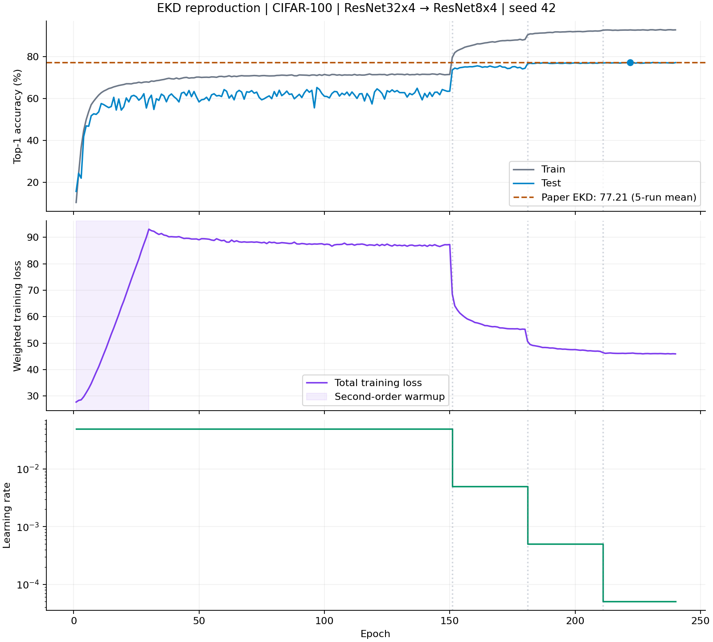

# 最终复现结果

2026-10-29，CIFAR-100，ResNet32×4 → ResNet8×4，seed=42，240 epochs。

| 模型 | 测试图数 | Top-1 | Top-5 |
| --- | ---: | ---: | ---: |
| 官方证据教师 | 10,000 | 79.53% | 94.86% |
| 本轮最佳学生（epoch 222） | 10,000 | **77.21%** | **94.14%** |
| 本轮末轮学生（epoch 240） | 10,000 | 77.11% | 93.98% |

论文表1该组合的 EKD Top-1 为五次运行均值 77.21%；本次单 seed 最佳结果在报告精度上与之相同，差 0.00 个百分点。不能据此声称完成五种子统计复现。没有额外跑普通 KD 或独训学生，不能把本文引用的基线当作本轮实测。

## 完成证据

- `artifacts/training-status.txt` 为 completed。
- 全部 240 条 epoch 记录连续；latest checkpoint 的 epoch=240，所有模型参数/状态有限。
- 最佳和末轮模型分别重新构造网络并重载 student checkpoint，在完整测试集评估。
- 最佳重载 Top-1 与 best checkpoint 记录一致。
- 纯模型 checkpoint：`artifacts/runs/cifar100_baselines/resnet32x4_resnet8x4_seed42/student_best` 和 `student_latest`。
- 带优化器状态的恢复点：同目录 `latest`；保留每 40 轮 checkpoint。
- 官方原始数据 MD5 已验证；官方教师重载精度与论文相同。
- 冒烟通过：KL 公式对照、有限梯度、学生更新、教师参数与 BN 状态不变、保存重载一致、真实数据一轮原 trainer 运行。

## 可公开结果

- [结构化摘要](../results/summary.json)
- [逐轮指标 CSV](../results/training-metrics.csv)：上游日志将数值舍入至小数点后两位。
- [训练曲线 PNG](../results/learning-curves.png) / [SVG](../results/learning-curves.svg)
- [教师评估](../results/teacher-eval.json)
- [最佳学生评估](../results/student-best-eval.json)
- [末轮学生评估](../results/student-last-eval.json)

前 30 轮二阶权重 warmup；官方调度器使用 epoch > stage，学习率实际在 151、181、211 轮下降。高学习率阶段测试准确率明显波动，第 156 轮达 75.08%，最终收敛到上述结果。未因中途波动改算法或调参。

## 环境与范围

使用兼容 RTX 6000D 的 NGC 25.12 PyTorch 运行时，与作者 Python/PyTorch 版本不同，详见 02-environment.md。本轮复用作者训练好的证据教师，没有重新训练 240 轮教师；无 OCR 迁移、ImageNet 或五种子实验。

完整日志和环境冻结仅保存在本地 logs/、artifacts/；公开仓库不上传数据、权重、PDF、checkpoint 或机器原始日志。来源和最小修复见 01-sources.md、03-issues.md。
